# Caso de uso 02: Analisar dados com o Apache Spark

**Cenário**

Uma empresa de varejo exporta seus pedidos de vendas como arquivos CSV a cada ano. A equipe de análise quer explorar esses dados, limpá-los e transformá-los, salvar os resultados em um formato adequado para análise e visualizar tendências rapidamente, tudo em uma única plataforma, sem alternar entre várias ferramentas.

Como engenheiro de dados, você criará um workspace e um lakehouse no Microsoft Fabric, fará o upload dos arquivos de pedidos de vendas e usará um notebook do Spark para carregar, explorar, transformar e visualizar os dados. Você também criará tabelas Delta gerenciadas e externas, consultará os dados com o Spark SQL e usará tabelas Delta para dados de streaming.

**Introdução**

O Apache Spark é um mecanismo de código aberto para processamento distribuído de dados e é amplamente utilizado para explorar, processar e analisar grandes volumes de dados no Data Lake Storage. O Spark está disponível como opção de processamento em diversos produtos de plataforma de dados, incluindo o Azure HDInsight, o Azure Databricks, o Azure Synapse Analytics e o Microsoft Fabric. Um dos benefícios do Spark é o suporte a uma ampla variedade de linguagens de programação, incluindo Java, Scala, Python e SQL, o que torna o Spark uma solução muito flexível para cargas de trabalho de processamento de dados, incluindo limpeza e manipulação de dados, análise estatística e machine learning, além de análise e visualização de dados.

As tabelas em um lakehouse do Microsoft Fabric são baseadas no formato de código aberto **Delta Lake** para o Apache Spark. O Delta Lake oferece suporte à semântica relacional para operações de dados em lote e em streaming e permite criar uma arquitetura de lakehouse na qual o Apache Spark é usado para processar e consultar dados em tabelas baseadas em arquivos de um data lake.

**Itens do Fabric criados neste laboratório**

| **Item** | **Nome** | **Função no laboratório** |
|----|----|----|
| Workspace | dp_Fabric\<ID da instância do laboratório\> | Contém todos os itens do laboratório |
| Lakehouse | Fabric_lakehouse | Armazena os arquivos de pedidos de vendas, os dados transformados e as tabelas Delta |
| Notebook | Explore Sales Orders | Notebook do Spark usado para explorar, transformar e visualizar os dados |
| Tabelas Delta | salesorders, external_salesorder, iotdevicedata | Tabela gerenciada, tabela externa e tabela de streaming |

**Objetivos**:

- Criar um workspace e um lakehouse no Microsoft Fabric e fazer o upload de arquivos de dados para análise.

- Criar um notebook para exploração e análise interativa de dados.

- Carregar dados em um DataFrame e filtrar, agrupar e agregar os dados.

- Transformar dados com o PySpark e salvar os dados transformados como arquivos Parquet e arquivos particionados.

- Criar no metastore do Spark a tabela Delta gerenciada **salesorders** e a tabela Delta externa **external_salesorder** e comparar suas propriedades.

- Executar consultas Spark SQL nas tabelas para análise.

- Visualizar dados usando bibliotecas do Python, como matplotlib e seaborn.

- Usar tabelas Delta para dados de streaming.

- Remover o workspace e os itens associados.

## Exercício 1: Criar um workspace, um lakehouse e um notebook e carregar dados em um DataFrame

Neste exercício, você cria um workspace e um lakehouse, faz o upload dos arquivos de pedidos de vendas e carrega os dados em um DataFrame em um notebook.

### Tarefa 1: Criar um workspace

1.  Abra o navegador, vá até a barra de endereços e digite ou cole a seguinte URL: +++https://app.fabric.microsoft.com/+++. Em seguida, pressione a tecla **Enter**.

**Observação**: Se você for direcionado diretamente para a página inicial do Microsoft Fabric, pule para a etapa 6.


2.  Na janela do **Microsoft Fabric**, insira suas credenciais e clique no botão **Submit**.

| **Nome de usuário** | **+++@lab.CloudPortalCredential(User1).Username+++** |
|----|----|
| **Senha** | **+++@lab.CloudPortalCredential(User1).Password+++** |


3.  Na janela **Microsoft**, insira a senha e clique no botão **Sign in**.


4.  Na janela **Stay signed in?**, clique no botão **Yes**.

5.  Se o Power BI abrir por padrão, siga as etapas abaixo; caso contrário, ignore esta etapa:

- Clique em **Power BI**.


- Selecione **Fabric** entre as opções exibidas.

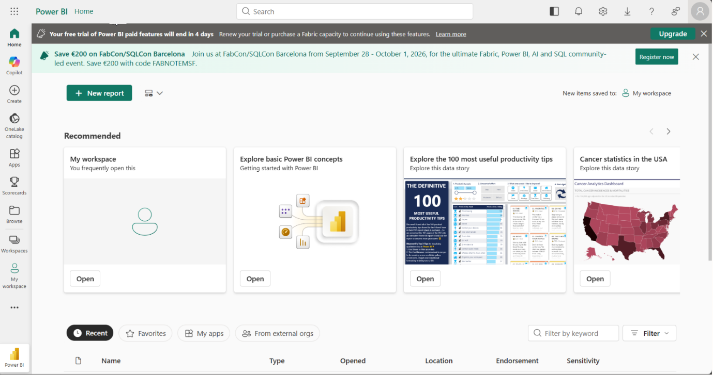

6.  Na página inicial do Fabric, selecione o bloco **+ New workspace**.

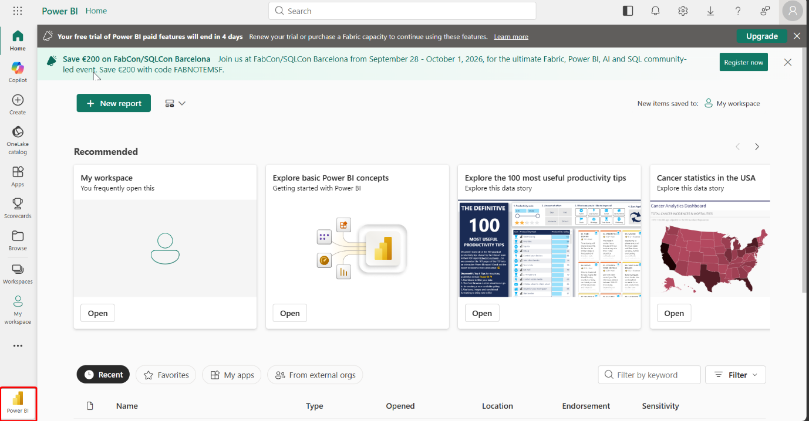

7.  No painel **Create a workspace**, insira os seguintes detalhes e clique no botão **Apply**.

| **Propriedade** | **Valor** |
|----|----|
| **Name** | +++dp_Fabric@lab.LabInstance.Id+++ (deve ser um nome exclusivo) |
| **Description** | +++Este workspace contém Analyze data with Apache Spark+++ |
| **Advanced** | Em **License mode**, selecione **Fabric** |
| **Default storage format** | **Small dataset storage format** |

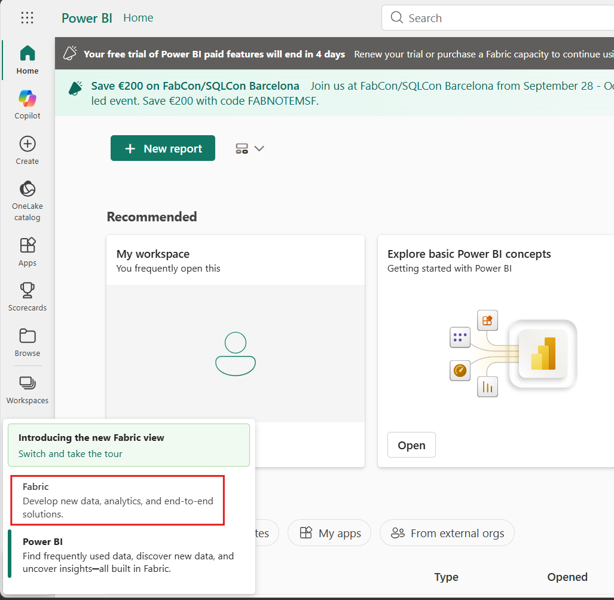


8.  Aguarde a conclusão da implantação. Esse processo leva de 2 a 3 minutos. Quando o novo workspace for aberto, ele deverá estar vazio.

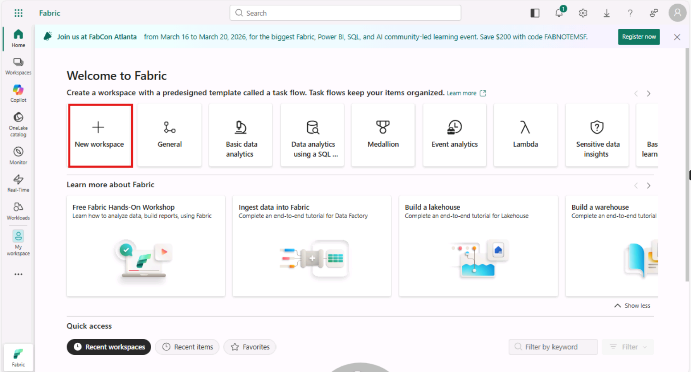

### Tarefa 2: Criar um lakehouse e carregar arquivos

Agora que você tem um workspace, é hora de criar um lakehouse para os arquivos de dados que você analisará.

1.  Crie um novo lakehouse clicando no botão **+ New item** na barra de navegação.

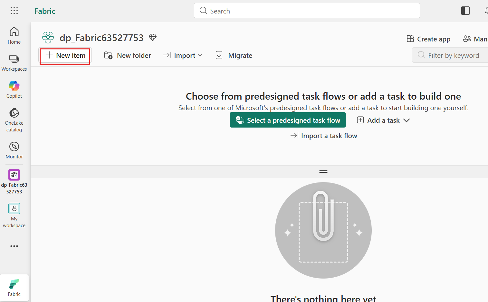

2.  Filtre por e selecione o bloco **Lakehouse**.

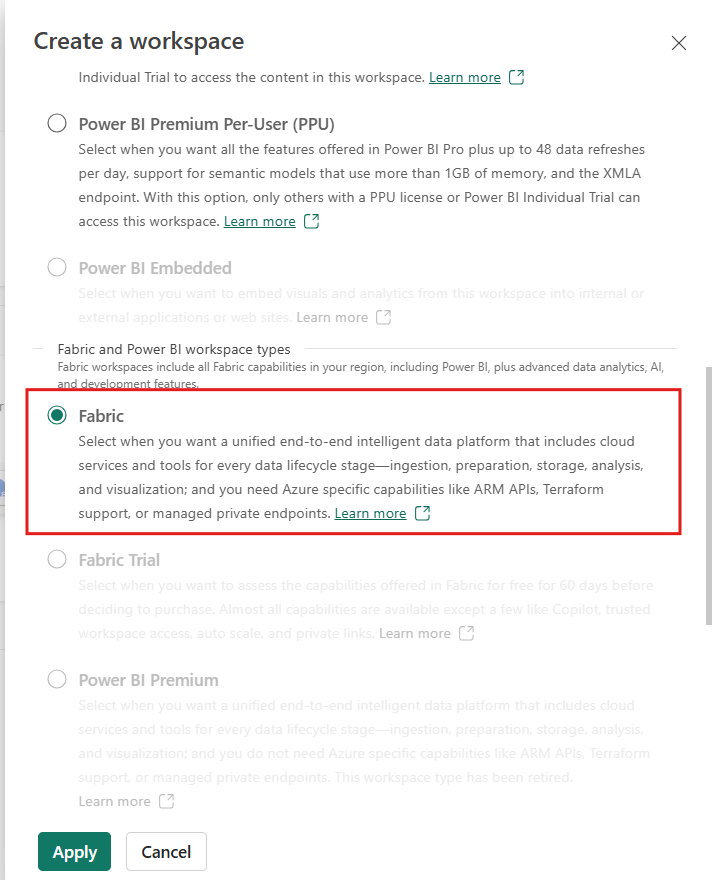

3.  Na caixa de diálogo **New lakehouse**, insira +++Fabric_lakehouse+++ no campo **Name**, clique no botão **Create** e abra o novo lakehouse.

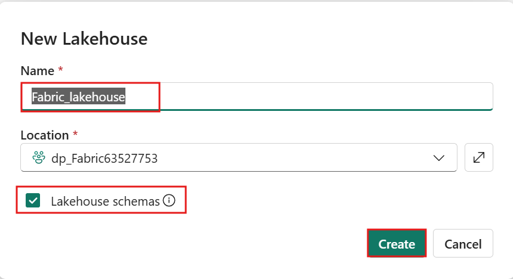

**Observação**: Após cerca de um minuto, um novo lakehouse vazio será criado. Você precisa ingerir alguns dados no lakehouse para análise.


4.  Você verá uma notificação informando **Successfully created SQL endpoint**.

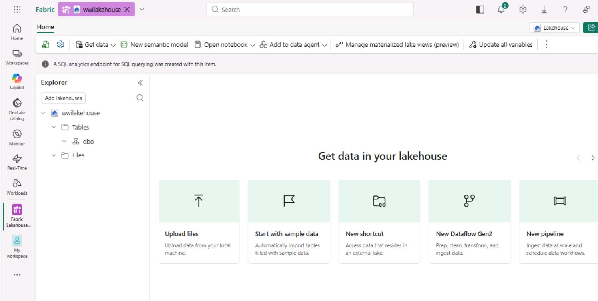

5.  Na seção **Explorer**, em **Fabric_lakehouse**, passe o cursor do mouse sobre a pasta **Files** e clique no menu de reticências horizontais **(...)**. Clique em **Upload** e, em seguida, em **Upload folder**.


6.  No painel **Upload folder**, que aparece no lado direito, selecione o ícone de pasta abaixo de **Files/**, navegue até **C:\LabFiles**, selecione a pasta **orders** e clique no botão **Upload**.

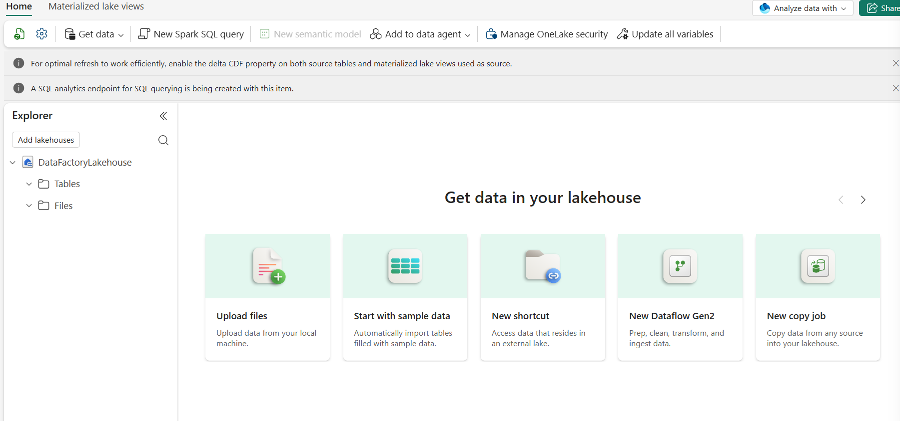

7.  Caso a caixa de diálogo **Upload 3 files to this site?** seja exibida, clique no botão **Upload**.

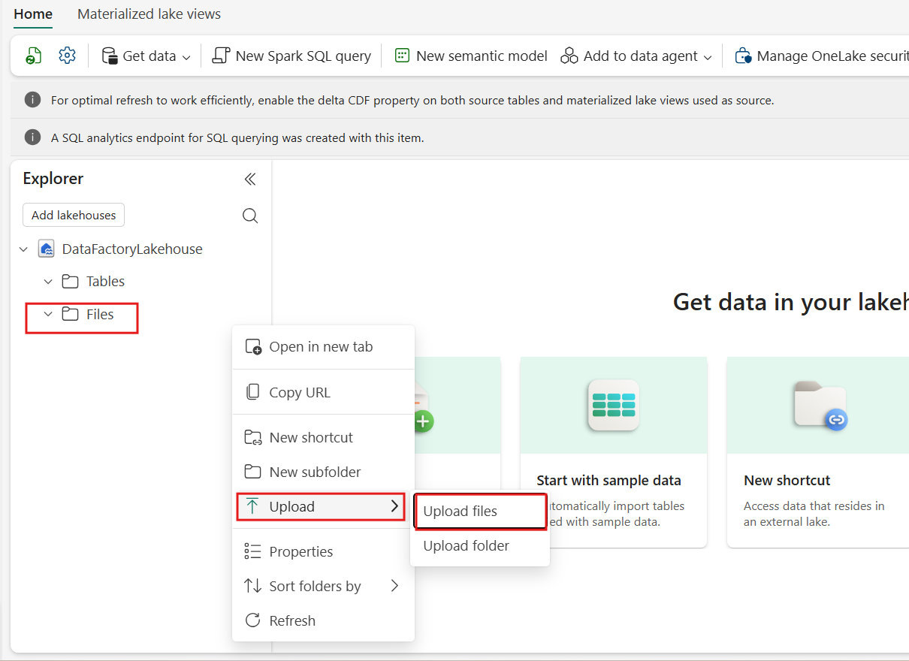

8.  No painel **Upload folder**, clique no botão **Upload**.

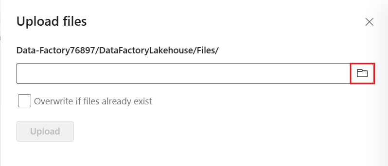

9.  Depois que os arquivos forem carregados, feche o painel **Upload folder**.

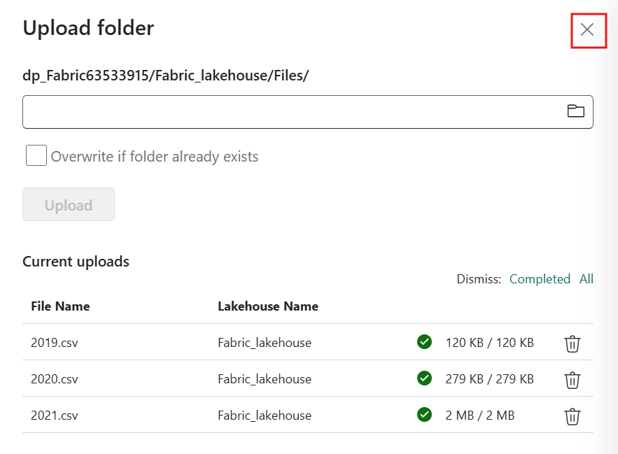

10. Expanda **Files**, selecione a pasta **orders** e verifique se os arquivos CSV foram carregados.

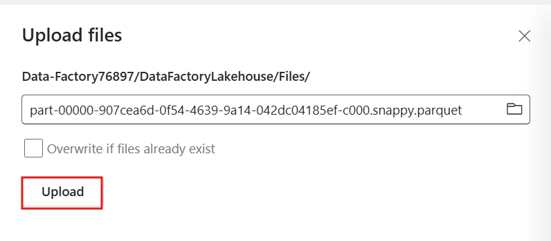

### Tarefa 3: Criar um notebook

Para trabalhar com dados no Apache Spark, você pode criar um *notebook*. Os notebooks fornecem um ambiente interativo no qual você pode escrever e executar código (em várias linguagens) e adicionar anotações para documentá-lo.

1.  Na aba **Home** do lakehouse, selecione o menu suspenso **Analyze data with**, aponte para **Notebook** e selecione **New notebook**.

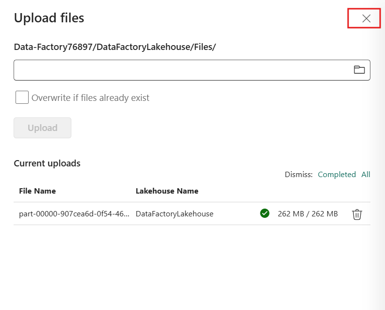

2.  Após alguns segundos, um novo notebook contendo uma única *célula* será aberto. Os notebooks são compostos por uma ou mais células que podem conter *código* ou *markdown* (texto formatado).

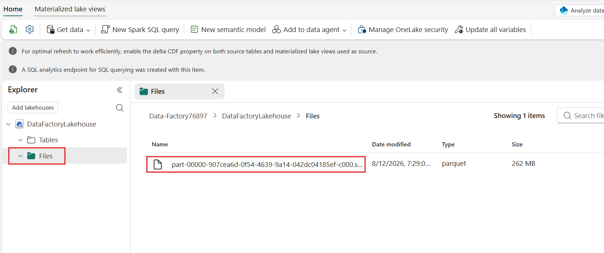

3.  Selecione a primeira célula (que atualmente é uma célula de *código*) e, na barra de ferramentas dinâmica no canto superior direito, use o botão **M↓** para converter a célula em uma célula de **markdown**.

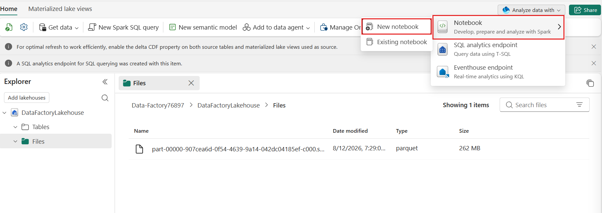

4.  Quando a célula for convertida em uma célula de markdown, o texto contido nela será renderizado.

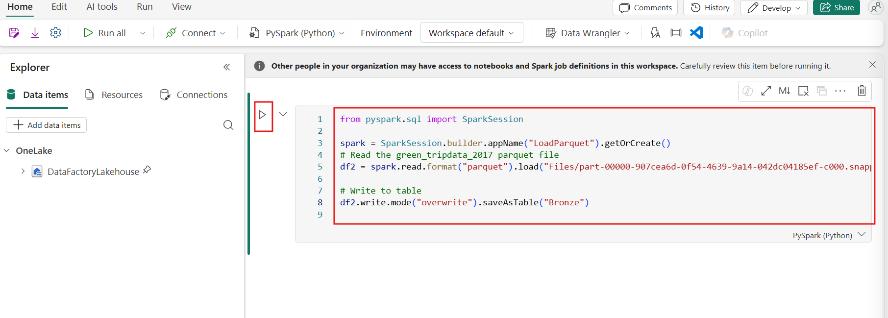

5.  Use o botão **🖉** (Edit) para alternar a célula para o modo de edição, substitua todo o texto e modifique o markdown da seguinte forma:

```text
# Sales order data exploration

Use the code in this notebook to explore sales order data.
```

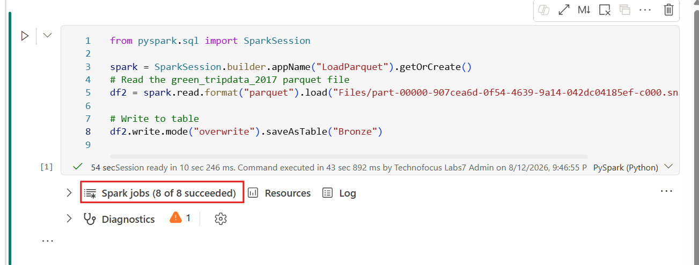

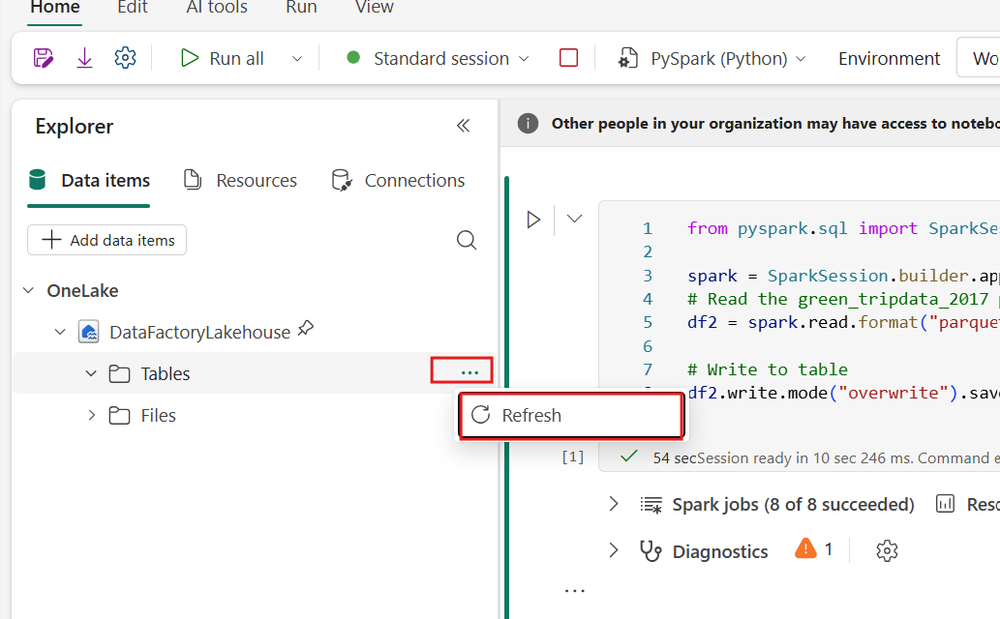

6.  Clique em qualquer lugar do notebook, fora da célula, para interromper a edição e visualizar o markdown renderizado.

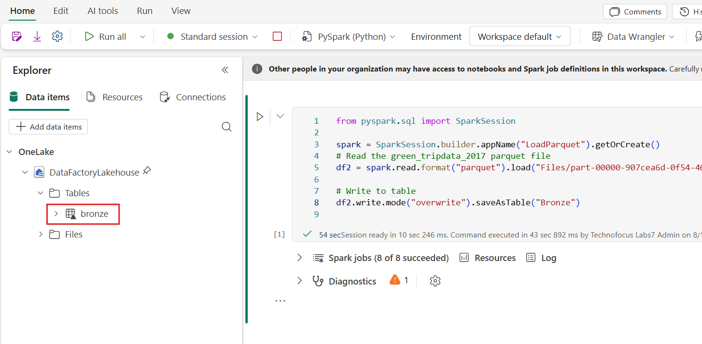

### Tarefa 4: Carregar dados em um DataFrame

Agora você está pronto para executar o código que carrega os dados em um *DataFrame*. Os DataFrames no Spark são semelhantes aos DataFrames do Pandas no Python e fornecem uma estrutura comum para trabalhar com dados organizados em linhas e colunas.

**Observação**: O Spark oferece suporte a várias linguagens de programação, incluindo Scala, Java e outras. Neste exercício, usaremos o *PySpark*, uma variante do Python otimizada para o Spark. O PySpark é uma das linguagens mais utilizadas no Spark e é a linguagem padrão nos notebooks do Fabric.

1.  Com o notebook visível, expanda a lista **Files** e selecione a pasta **orders** para que os arquivos CSV sejam listados ao lado do editor do notebook.

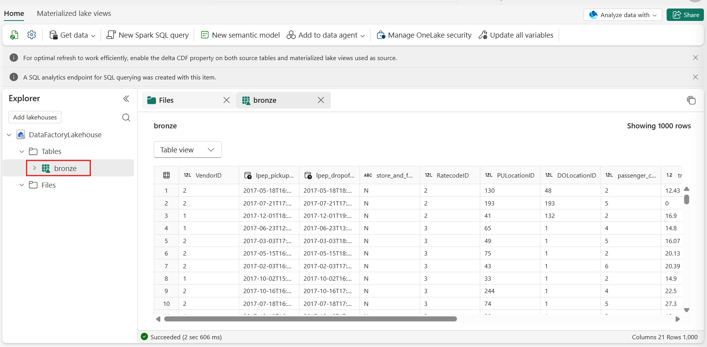

2.  Passe o cursor do mouse sobre o arquivo **2019.csv**, clique nas reticências horizontais **(...)** ao lado dele, clique em **Load data** e selecione **Spark**. Uma nova célula de código contendo o código a seguir será adicionada ao notebook:

```python
df = spark.read.format("csv").option("header","true").load("Files/orders/2019.csv")
# df now is a Spark DataFrame containing CSV data from "Files/orders/2019.csv".
display(df)
```

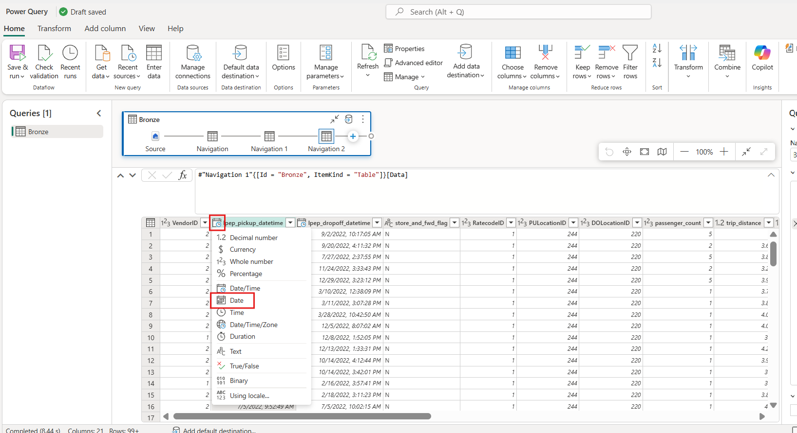

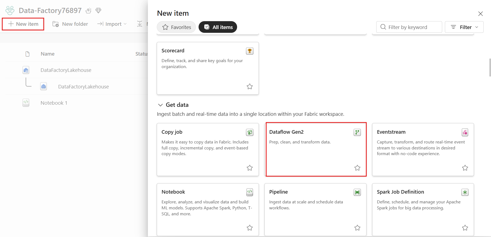

**Dica**: Você pode ocultar o painel Lakehouse Explorer à esquerda usando o ícone **«**. Isso ajudará você a se concentrar no notebook.

3.  Use o botão **▷ Run cell** à esquerda da célula para executá-la.

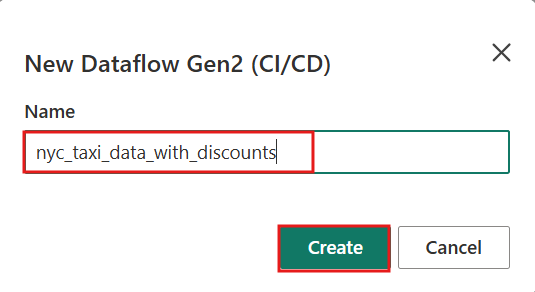

**Observação**: Como esta é a primeira vez que você executa código do Spark, uma sessão do Spark precisa ser iniciada. Isso significa que a primeira execução na sessão pode levar cerca de um minuto. As execuções seguintes serão mais rápidas.

4.  Quando o comando da célula for concluído, revise a saída abaixo da célula, que deverá ser semelhante a esta:

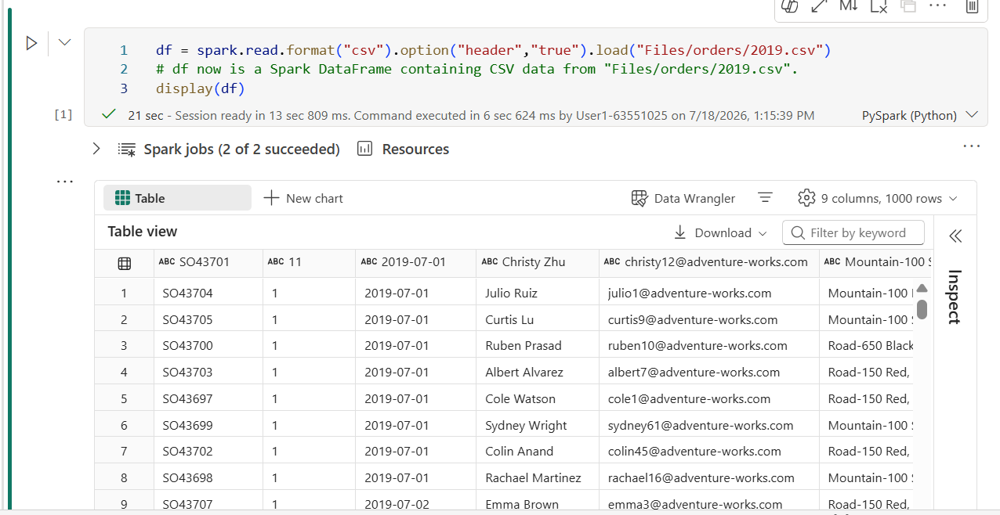

5.  A saída mostra as linhas e colunas de dados do arquivo 2019.csv. No entanto, observe que os cabeçalhos das colunas não estão corretos. O código padrão usado para carregar os dados em um DataFrame pressupõe que o arquivo CSV contém os nomes das colunas na primeira linha, mas, neste caso, o arquivo CSV contém apenas os dados, sem informações de cabeçalho.

6.  Modifique o código para definir a opção **header** como **false**. Substitua todo o código da célula pelo código a seguir, clique no botão **▷ Run cell** e revise a saída.

```python
df = spark.read.format("csv").option("header","false").load("Files/orders/2019.csv")
# df now is a Spark DataFrame containing CSV data from "Files/orders/2019.csv".
display(df)
```

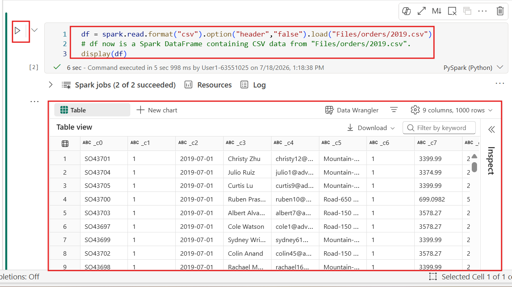

7.  Agora, o DataFrame inclui corretamente a primeira linha como valores de dados, mas os nomes das colunas são gerados automaticamente e não são muito úteis. Para compreender os dados, você precisa definir explicitamente o esquema e os tipos de dados corretos para os valores contidos no arquivo.

8.  Substitua todo o código da célula pelo código a seguir, clique no botão **▷ Run cell** e revise a saída.

```python
from pyspark.sql.types import *

orderSchema = StructType([
    StructField("SalesOrderNumber", StringType()),
    StructField("SalesOrderLineNumber", IntegerType()),
    StructField("OrderDate", DateType()),
    StructField("CustomerName", StringType()),
    StructField("Email", StringType()),
    StructField("Item", StringType()),
    StructField("Quantity", IntegerType()),
    StructField("UnitPrice", FloatType()),
    StructField("Tax", FloatType())
])

df = spark.read.format("csv").schema(orderSchema).load("Files/orders/2019.csv")
display(df)
```

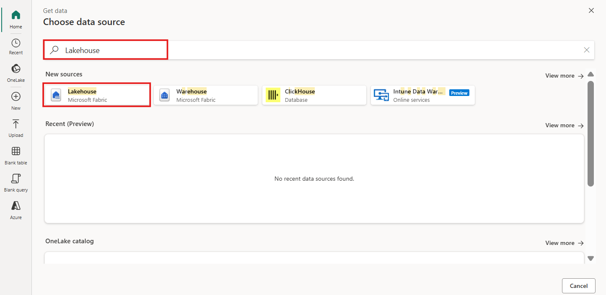

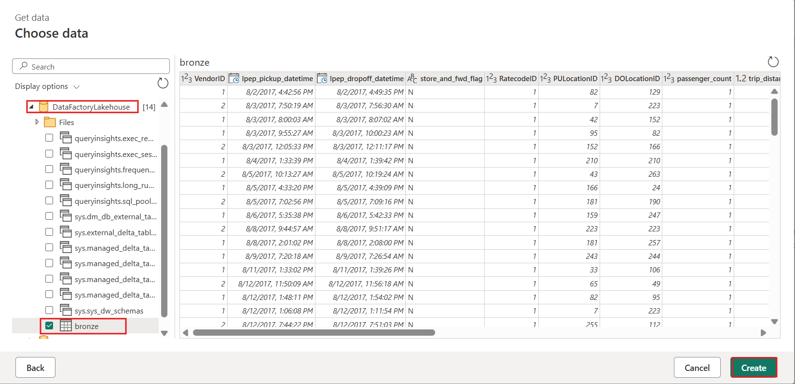

9.  Agora, o DataFrame inclui os nomes corretos das colunas. Os tipos de dados das colunas são especificados usando um conjunto padrão de tipos definido na biblioteca Spark SQL, que foi importada no início da célula.

10. Use o ícone **+ Code** abaixo da saída da célula para adicionar uma nova célula de código ao notebook e insira o código a seguir. Clique no botão **▷ Run cell** para confirmar que as alterações foram aplicadas aos dados.

```python
display(df)
```

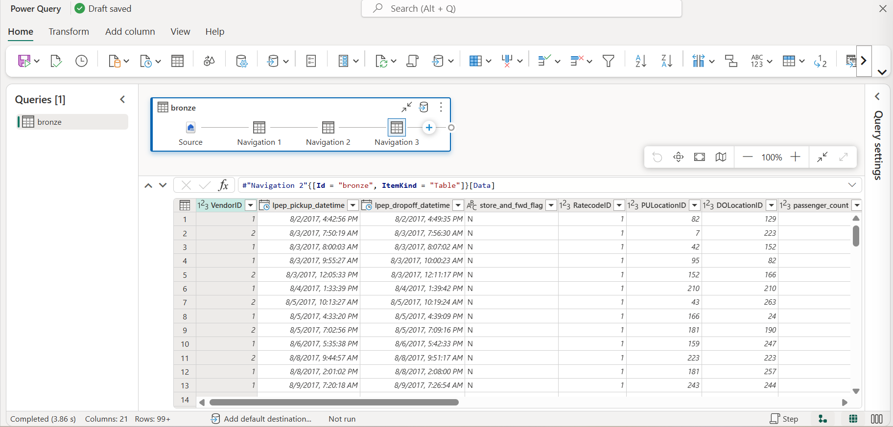

11. O DataFrame inclui apenas os dados do arquivo **2019.csv**. Em seguida, você modificará o código para que o caminho do arquivo use um caractere curinga \* para ler os dados dos pedidos de vendas de todos os arquivos da pasta **orders**.

12. Use o ícone **+ Code** abaixo da saída da célula para adicionar uma nova célula de código ao notebook e insira o código a seguir.

```python
from pyspark.sql.types import *

orderSchema = StructType([
    StructField("SalesOrderNumber", StringType()),
    StructField("SalesOrderLineNumber", IntegerType()),
    StructField("OrderDate", DateType()),
    StructField("CustomerName", StringType()),
    StructField("Email", StringType()),
    StructField("Item", StringType()),
    StructField("Quantity", IntegerType()),
    StructField("UnitPrice", FloatType()),
    StructField("Tax", FloatType())
])

df = spark.read.format("csv").schema(orderSchema).load("Files/orders/*.csv")
display(df)
```

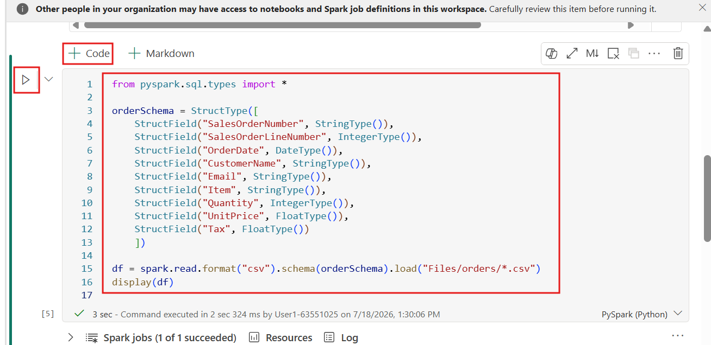

13. Execute a célula de código modificada e revise a saída, que agora deverá incluir os dados de vendas de 2019, 2020 e 2021.


**Observação**: Apenas um subconjunto das linhas é exibido, portanto talvez você não veja exemplos de todos os anos.

## Exercício 2: Explorar dados em um DataFrame

O objeto DataFrame inclui uma ampla variedade de funções que você pode usar para filtrar, agrupar e manipular os dados que ele contém.

### Tarefa 1: Filtrar um DataFrame

1.  Use o ícone **+ Code** abaixo da saída da célula para adicionar uma nova célula de código ao notebook e insira o código a seguir.

```python
customers = df['CustomerName', 'Email']
print(customers.count())
print(customers.distinct().count())
display(customers.distinct())
```

2.  **Execute** a nova célula de código e revise os resultados. Observe os seguintes detalhes:

- Quando você realiza uma operação em um DataFrame, o resultado é um novo DataFrame (neste caso, um novo DataFrame **customers** é criado selecionando um subconjunto específico de colunas do DataFrame **df**).

- Os DataFrames fornecem funções como **count** e **distinct**, que podem ser usadas para resumir e filtrar os dados que eles contêm.

- A sintaxe `dataframe['Field1', 'Field2', ...]` é uma forma abreviada de definir um subconjunto de colunas. Você também pode usar o método **select**; portanto, a primeira linha do código acima poderia ser escrita como `customers = df.select("CustomerName", "Email")`.

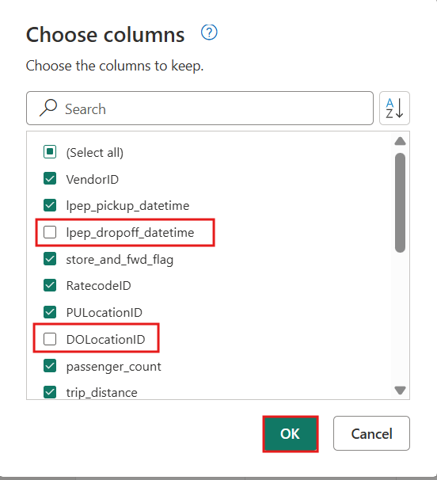

3.  Substitua todo o código da célula pelo código a seguir e clique no botão **▷ Run cell**.

```python
customers = df.select("CustomerName", "Email").where(df['Item']=='Road-250 Red, 52')
print(customers.count())
print(customers.distinct().count())
display(customers.distinct())
```

4.  Revise os resultados para ver os clientes que compraram o produto **Road-250 Red, 52**. Observe que você pode "encadear" várias funções, de modo que a saída de uma função se torne a entrada da próxima. Neste caso, o DataFrame criado pelo método **select** é o DataFrame de origem do método **where**, que é usado para aplicar os critérios de filtragem.

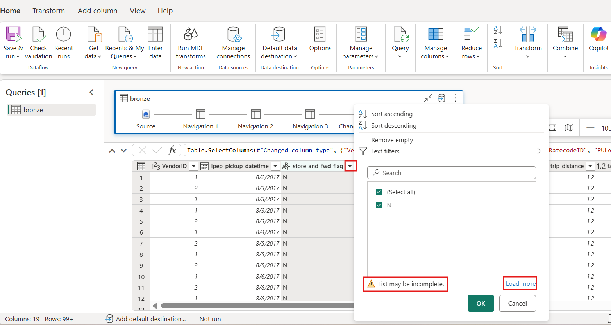

### Tarefa 2: Agregar e agrupar dados em um DataFrame

1.  Clique em **+ Code**, copie e cole o código abaixo e clique no botão **Run cell**.

```python
productSales = df.select("Item", "Quantity").groupBy("Item").sum()
display(productSales)
```

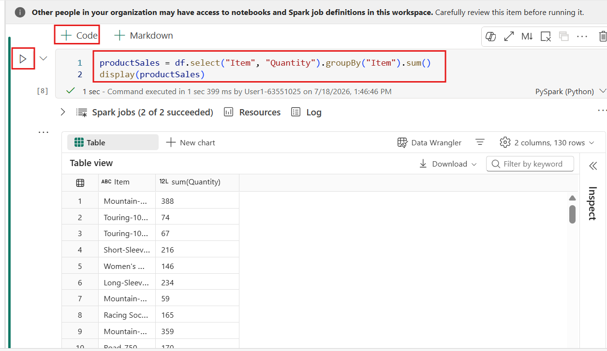

2.  Observe que os resultados mostram a soma das quantidades pedidas agrupadas por produto. O método **groupBy** agrupa as linhas por *Item*, e a função de agregação **sum** subsequente é aplicada a todas as colunas numéricas restantes (neste caso, *Quantity*).

3.  Clique em **+ Code**, copie e cole o código abaixo e clique no botão **Run cell**.

```python
from pyspark.sql.functions import *

yearlySales = df.select(year("OrderDate").alias("Year")).groupBy("Year").count().orderBy("Year")
display(yearlySales)
```

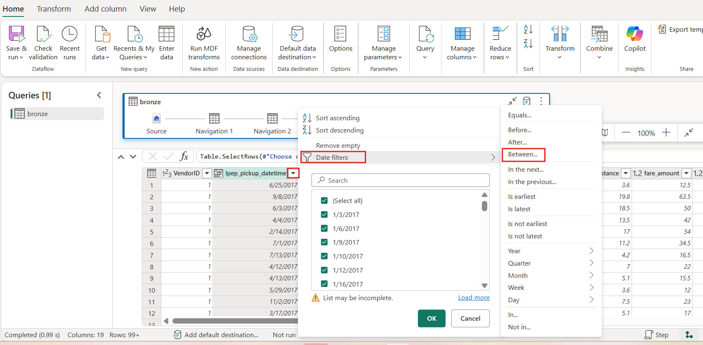

4.  Observe que os resultados mostram o número de pedidos de vendas por ano. O método **select** inclui uma função SQL **year** para extrair o componente de ano do campo *OrderDate* (por isso o código inclui uma instrução **import** para importar funções da biblioteca Spark SQL). Em seguida, o método **alias** é usado para atribuir um nome de coluna ao valor de ano extraído. Os dados são então agrupados pela coluna *Year* derivada, a contagem de linhas de cada grupo é calculada e, por fim, o método **orderBy** é usado para classificar o DataFrame resultante.

## Exercício 3: Usar o Spark para transformar arquivos de dados

Uma tarefa comum dos engenheiros de dados é ingerir dados em um determinado formato ou estrutura e transformá-los para processamento ou análise posterior.

### Tarefa 1: Usar métodos e funções de DataFrame para transformar dados

1.  Clique em **+ Code** e copie e cole o código abaixo.

```python
from pyspark.sql.functions import *

## Create Year and Month columns
transformed_df = df.withColumn("Year", year(col("OrderDate"))).withColumn("Month", month(col("OrderDate")))

# Create the new FirstName and LastName fields
transformed_df = transformed_df.withColumn("FirstName", split(col("CustomerName"), " ").getItem(0)).withColumn("LastName", split(col("CustomerName"), " ").getItem(1))

# Filter and reorder columns
transformed_df = transformed_df["SalesOrderNumber", "SalesOrderLineNumber", "OrderDate", "Year", "Month", "FirstName", "LastName", "Email", "Item", "Quantity", "UnitPrice", "Tax"]

# Display the first five orders
display(transformed_df.limit(5))
```

2.  **Execute** o código para criar um novo DataFrame a partir dos dados originais dos pedidos, aplicando as seguintes transformações:

- Adicionar as colunas **Year** e **Month** com base na coluna **OrderDate**.

- Adicionar as colunas **FirstName** e **LastName** com base na coluna **CustomerName**.

- Filtrar e reordenar as colunas, removendo a coluna **CustomerName**.

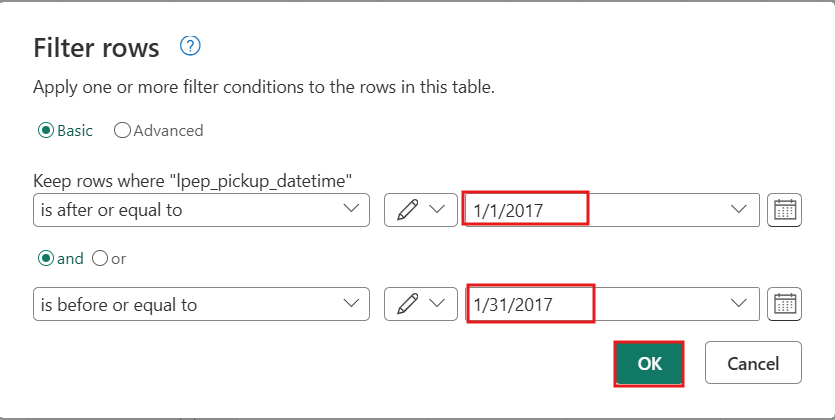

3.  Revise a saída e verifique se as transformações foram aplicadas aos dados.

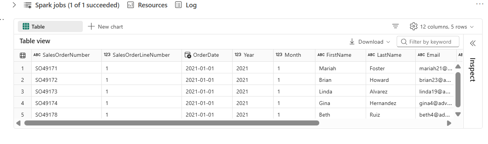

Você pode usar todo o potencial da biblioteca Spark SQL para transformar os dados, filtrando linhas, derivando, removendo ou renomeando colunas e aplicando quaisquer outras modificações necessárias.

**Dica**: Consulte a [*Spark DataFrame documentation*](https://spark.apache.org/docs/latest/api/python/reference/pyspark.sql/dataframe.html) para saber mais sobre os métodos do objeto DataFrame.

### Tarefa 2: Salvar os dados transformados

1.  Adicione uma nova célula com o código a seguir para salvar o DataFrame transformado no formato Parquet (substituindo os dados, caso já existam). **Execute** a célula e aguarde a mensagem informando que os dados foram salvos.

```python
transformed_df.write.mode("overwrite").parquet('Files/transformed_data/orders')
print ("Transformed data saved!")
```

**Observação**: Geralmente, o formato *Parquet* é preferido para arquivos de dados que serão usados em análises posteriores ou ingeridos em um armazenamento analítico. O Parquet é um formato muito eficiente e compatível com a maioria dos sistemas de análise de dados em larga escala. Na verdade, às vezes o requisito de transformação de dados pode ser simplesmente converter os dados de outro formato (como CSV) para Parquet!

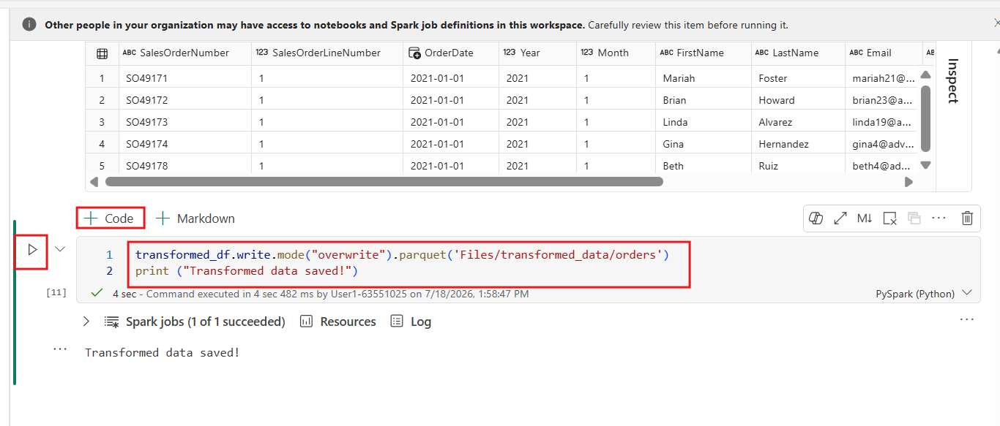

2.  No painel **Lakehouse explorer**, à esquerda, no menu **...** do nó **Files**, selecione **Refresh**.

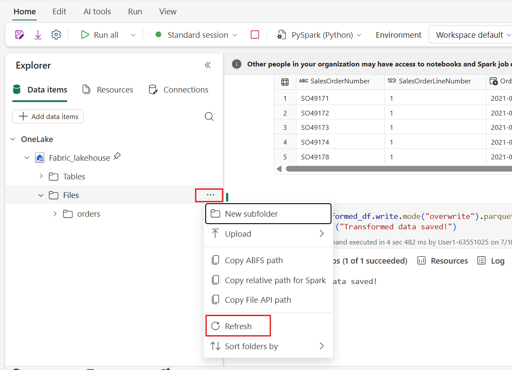

3.  Clique na pasta **transformed_data** para verificar se ela contém uma nova pasta chamada **orders**, que, por sua vez, contém um ou mais arquivos **Parquet**.

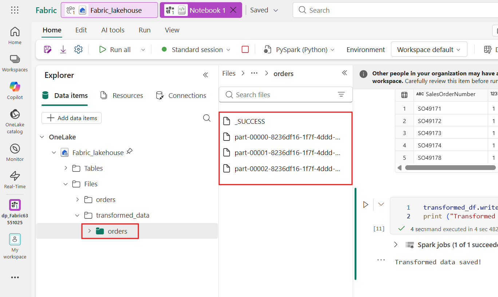

4.  Clique em **+ Code** e insira o código a seguir para carregar um novo DataFrame a partir dos arquivos Parquet da pasta **transformed_data -\> orders**:

```python
orders_df = spark.read.format("parquet").load("Files/transformed_data/orders")
display(orders_df)
```

5.  **Execute** a célula e verifique se os resultados mostram os dados dos pedidos carregados a partir dos arquivos Parquet.

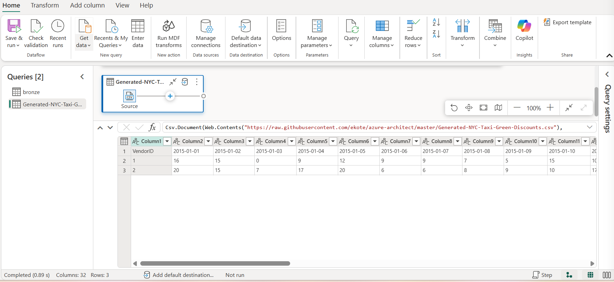

### Tarefa 3: Salvar dados em arquivos particionados

1.  Clique em **+ Code** para adicionar uma nova célula e insira o código a seguir, que salva o DataFrame particionando os dados por **Year** e **Month**. **Execute** a célula e aguarde a mensagem informando que os dados foram salvos.

```python
orders_df.write.partitionBy("Year","Month").mode("overwrite").parquet("Files/partitioned_data")
print ("Transformed data saved!")
```


2.  No painel **Lakehouse explorer**, à esquerda, no menu **...** do nó **Files**, selecione **Refresh**.


3.  Expanda a pasta **partitioned_data** para verificar se ela contém uma hierarquia de pastas denominadas **Year=xxxx**, cada uma contendo pastas denominadas **Month=xxxx**. Cada pasta de mês contém um arquivo Parquet com os pedidos daquele mês.

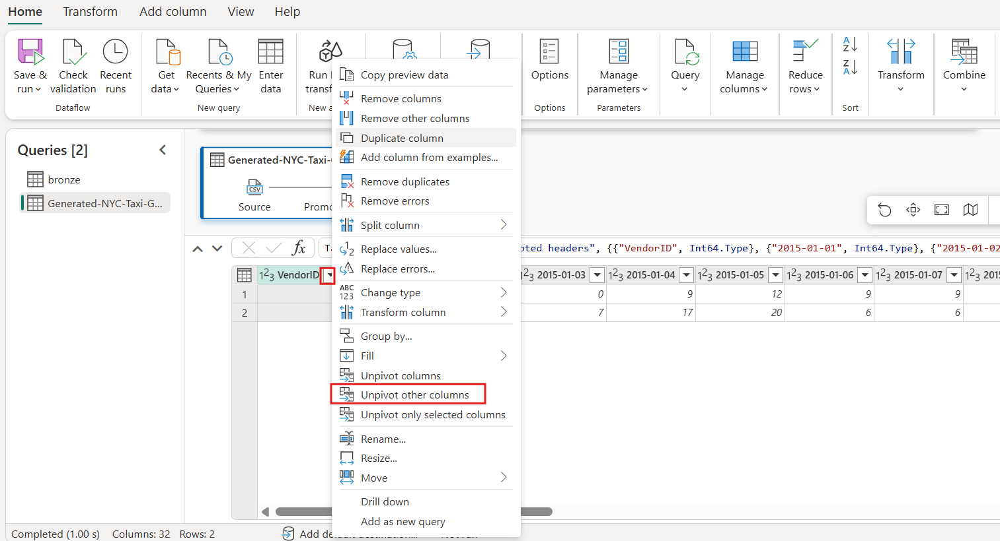

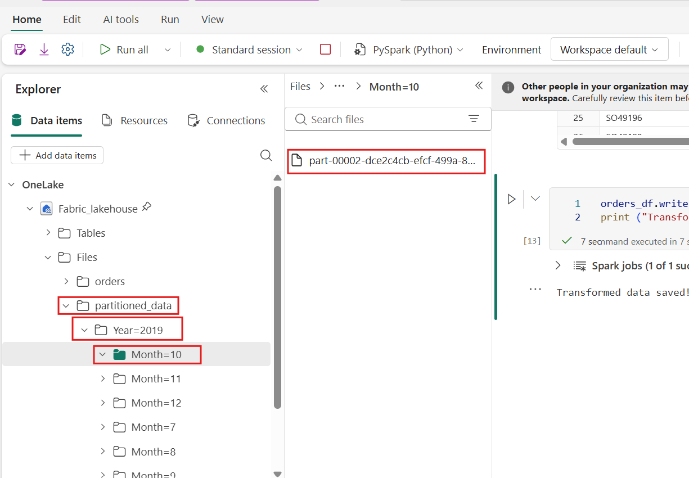

O particionamento de arquivos de dados é uma forma comum de otimizar o desempenho ao trabalhar com grandes volumes de dados. Essa técnica pode melhorar significativamente o desempenho e facilitar a filtragem dos dados.

4.  Clique em **+ Code** para adicionar uma nova célula e insira o código a seguir para carregar os pedidos de 2021 dos dados particionados em um novo DataFrame:

```python
orders_2021_df = spark.read.format("parquet").load("Files/partitioned_data/Year=2021/Month=*")
display(orders_2021_df)
```

5.  **Execute** a célula e verifique se os resultados mostram os dados dos pedidos de vendas de 2021. Observe que as colunas de particionamento especificadas no caminho (**Year** e **Month**) não estão incluídas no DataFrame.


## Exercício 4: Trabalhar com tabelas e SQL

Como você viu, os métodos nativos do objeto DataFrame permitem consultar e analisar dados de um arquivo com bastante eficiência. No entanto, muitos analistas de dados preferem trabalhar com tabelas que podem consultar usando a sintaxe SQL. O Spark fornece um *metastore*, no qual você pode definir tabelas relacionais. A biblioteca Spark SQL, que fornece o objeto DataFrame, também oferece suporte ao uso de instruções SQL para consultar tabelas no metastore. Ao usar esses recursos do Spark, você pode combinar a flexibilidade de um data lake com o esquema de dados estruturado e as consultas baseadas em SQL de um data warehouse relacional — daí o termo "data lakehouse".

### Tarefa 1: Criar uma tabela gerenciada

As tabelas em um metastore do Spark são abstrações relacionais sobre arquivos no data lake. As tabelas podem ser *gerenciadas* (nesse caso, os arquivos são gerenciados pelo metastore) ou *externas* (nesse caso, a tabela faz referência a um local de arquivos no data lake que você gerencia independentemente do metastore).

1.  Clique em **+ Code** no notebook para adicionar uma nova célula de código e insira o código a seguir, que salva o DataFrame com os dados dos pedidos de vendas como uma tabela chamada **salesorders**:

```python
# Create a new table
df.write.format("delta").saveAsTable("salesorders")

# Get the table description
spark.sql("DESCRIBE EXTENDED salesorders").show(truncate=False)
```

**Observação**: Vale destacar alguns pontos sobre este exemplo. Primeiro, nenhum caminho explícito é fornecido, portanto os arquivos da tabela serão gerenciados pelo metastore. Segundo, a tabela é salva no formato **delta**. Você pode criar tabelas com base em vários formatos de arquivo (incluindo CSV, Parquet, Avro e outros), mas o *Delta Lake* é uma tecnologia do Spark que adiciona recursos de banco de dados relacional às tabelas, incluindo suporte a transações, versionamento de linhas e outros recursos úteis. A criação de tabelas no formato delta é recomendada para data lakehouses no Fabric.

2.  **Execute** a célula de código e revise a saída, que descreve a definição da nova tabela.

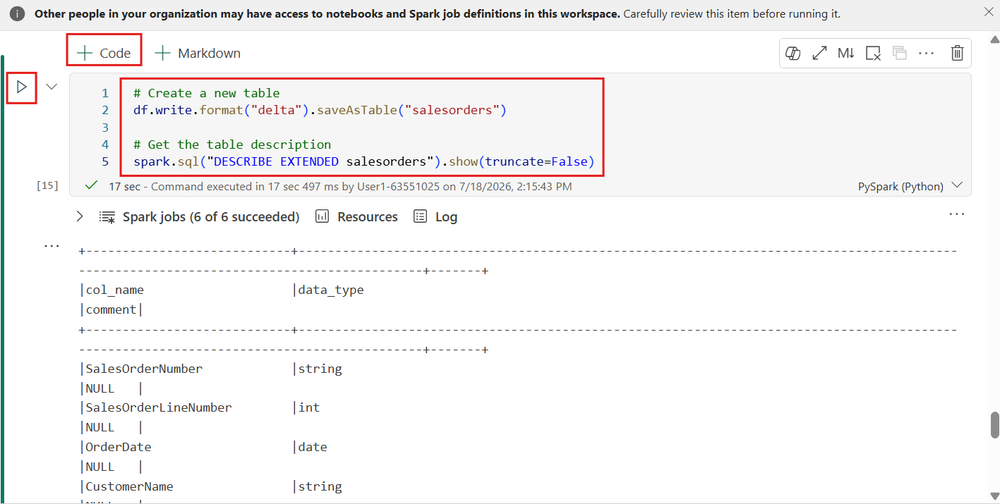

3.  No painel **Lakehouse explorer**, no menu **...** da pasta **Tables**, selecione **Refresh**.


4.  Expanda o nó **Tables** e verifique se a tabela **salesorders** foi criada no esquema **dbo**.

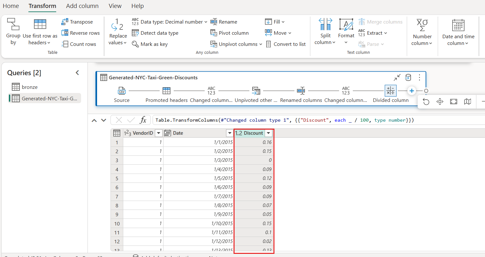

5.  Passe o cursor do mouse sobre a tabela **salesorders**, clique nas reticências horizontais **(...)**, clique em **Load data** e selecione **Spark**.

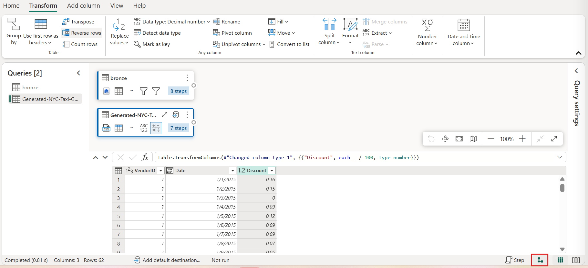

6.  Uma nova célula de código é adicionada ao notebook. Ela usa a biblioteca Spark SQL para incorporar ao código PySpark uma consulta SQL na tabela **salesorders** e carregar os resultados da consulta em um DataFrame. O código gerado é semelhante ao seguinte. Clique no botão **▷ Run cell** para executá-lo.

```python
df = spark.sql("SELECT * FROM Fabric_lakehouse.dbo.salesorders LIMIT 1000")
display(df)
```

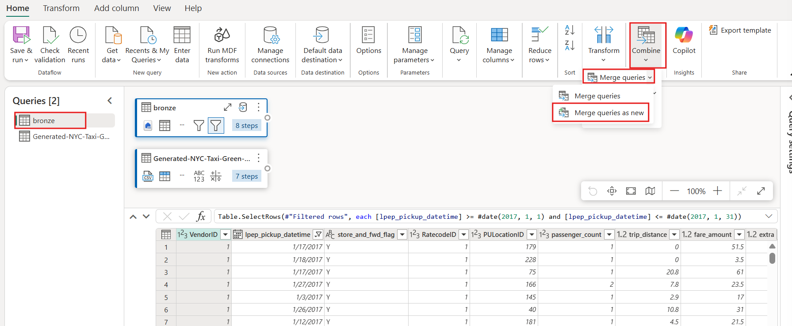

### Tarefa 2: Criar uma tabela externa

Você também pode criar tabelas *externas*, nas quais os metadados do esquema são definidos no metastore do lakehouse, mas os arquivos de dados são armazenados em um local externo.

1.  Abaixo dos resultados retornados pela primeira célula de código, use o botão **+ Code** para adicionar uma nova célula de código, caso ainda não exista. Em seguida, insira o código a seguir na nova célula.

```python
df.write.format("delta").saveAsTable("external_salesorder", path="<abfs_path>/external_salesorder")
```


2.  No painel **Lakehouse explorer**, no menu **...** da pasta **Files**, selecione **Copy ABFS path** e cole o caminho no Bloco de Notas.

O caminho ABFS é o caminho totalmente qualificado da pasta **Files** no armazenamento OneLake do seu lakehouse, semelhante a este:

```text
abfss://dp_Fabric<lab instance ID>@onelake.dfs.fabric.microsoft.com/Fabric_lakehouse.Lakehouse/Files
```

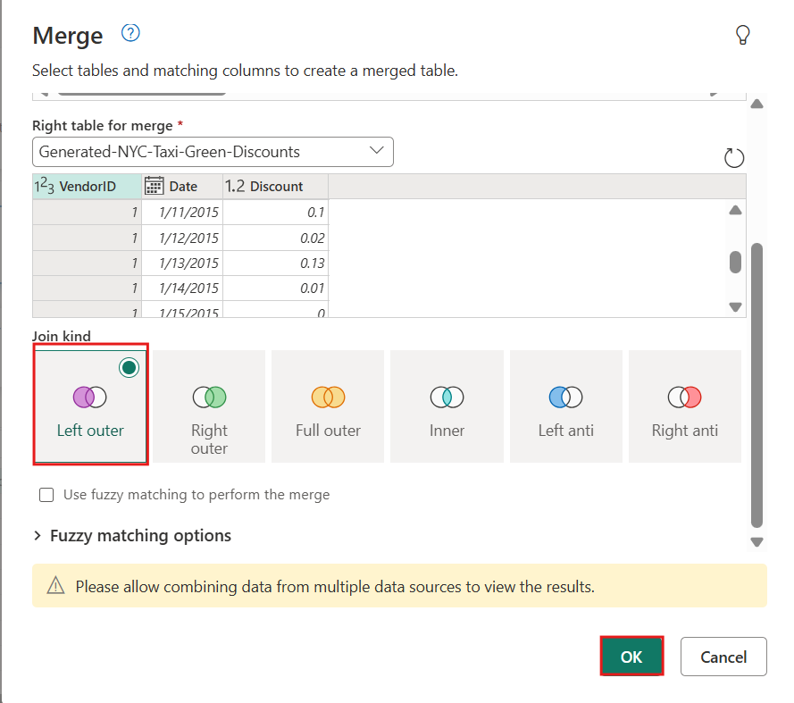

3.  Volte para a célula de código e substitua **\<abfs_path\>** pelo caminho que você copiou para o Bloco de Notas, para que o código salve o DataFrame como uma tabela externa, com os arquivos de dados em uma pasta chamada **external_salesorder** dentro da pasta **Files**. O caminho completo deverá ser semelhante a este:

```text
abfss://dp_Fabric<lab instance ID>@onelake.dfs.fabric.microsoft.com/Fabric_lakehouse.Lakehouse/Files/external_salesorder
```

4.  Use o botão **▷ (Run cell)** à esquerda da célula para executá-la.

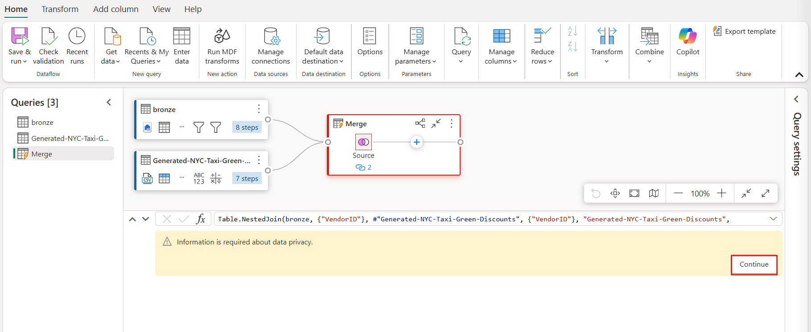

5.  No painel **Lakehouse explorer**, no menu **...** da pasta **Tables**, selecione **Refresh**.

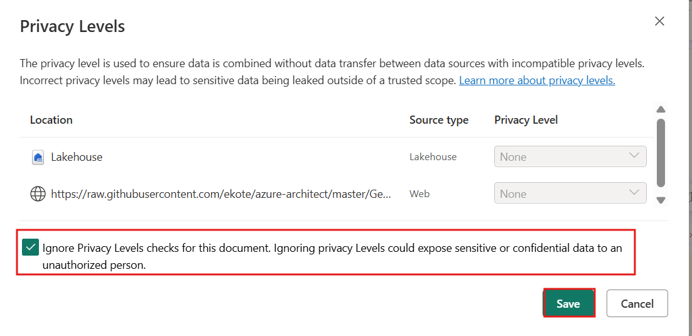

6.  Expanda o nó **Tables** e verifique se a tabela **external_salesorder** foi criada.

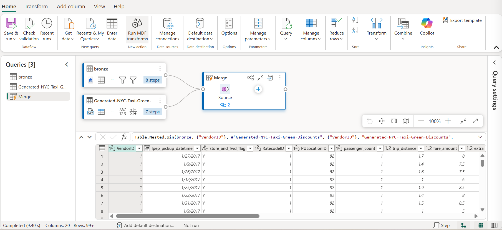

7.  No painel **Lakehouse explorer**, no menu **...** da pasta **Files**, selecione **Refresh**.


8.  Expanda o nó **Files** e verifique se a pasta **external_salesorder** foi criada para os arquivos de dados da tabela.


### Tarefa 3: Comparar tabelas gerenciadas e externas

Vamos explorar as diferenças entre tabelas gerenciadas e externas.

1.  Abaixo dos resultados retornados pela célula de código, use o botão **+ Code** para adicionar uma nova célula de código. Copie o código abaixo para a célula de código e use o botão **▷ (Run cell)** à esquerda da célula para executá-la.

```sql
%%sql

DESCRIBE FORMATTED salesorders;
```


2.  Nos resultados, visualize a propriedade **Location** da tabela, que deverá ser um caminho para o armazenamento OneLake do lakehouse terminando em **/Tables/salesorders** (talvez seja necessário ampliar a coluna **Data type** para ver o caminho completo).


3.  Em seguida, modifique o comando **DESCRIBE** para exibir os detalhes da tabela **external_salesorder**. Abaixo dos resultados retornados pela célula de código, use o botão **+ Code** para adicionar uma nova célula de código, copie o código abaixo e use o botão **▷ (Run cell)** à esquerda da célula para executá-la.

```sql
%%sql

DESCRIBE FORMATTED external_salesorder;
```

4.  Nos resultados, visualize a propriedade **Location** da tabela, que deverá ser um caminho para o armazenamento OneLake do lakehouse terminando em **/Files/external_salesorder** (talvez seja necessário ampliar a coluna **Data type** para ver o caminho completo).


### Tarefa 4: Executar código SQL em uma célula

Embora seja útil poder incorporar instruções SQL em uma célula que contém código PySpark, os analistas de dados geralmente querem trabalhar diretamente em SQL.

1.  Clique em **+ Code** no notebook e insira o código a seguir. Clique no botão **▷ Run cell** e revise os resultados. Observe que:

- A linha `%%sql` no início da célula (chamada de *magic*) indica que o runtime da linguagem Spark SQL deve ser usado para executar o código dessa célula, em vez do PySpark.

- O código SQL faz referência à tabela **salesorders** que você criou anteriormente.

- A saída da consulta SQL é exibida automaticamente como resultado abaixo da célula.

```sql
%%sql
SELECT YEAR(OrderDate) AS OrderYear,
       SUM((UnitPrice * Quantity) + Tax) AS GrossRevenue
FROM salesorders
GROUP BY YEAR(OrderDate)
ORDER BY OrderYear;
```


**Observação**: Para obter mais informações sobre o Spark SQL e os DataFrames, consulte a [*Spark SQL documentation*](https://spark.apache.org/docs/2.2.0/sql-programming-guide.html).

## Exercício 5: Visualizar dados com o Spark

Uma imagem vale mais que mil palavras, e um gráfico geralmente é melhor do que mil linhas de dados. Embora os notebooks do Fabric incluam uma exibição de gráfico integrada para os dados exibidos a partir de um DataFrame ou de uma consulta Spark SQL, ela não foi projetada para gráficos abrangentes. No entanto, você pode usar bibliotecas gráficas do Python, como **matplotlib** e **seaborn**, para criar gráficos a partir dos dados de DataFrames.

### Tarefa 1: Exibir resultados como um gráfico

1.  Clique em **+ Code** no notebook e insira o código a seguir. Clique no botão **▷ Run cell** e observe que ele retorna os dados da tabela **salesorders** que você criou anteriormente.

```sql
%%sql
SELECT * FROM salesorders
```


2.  Na seção de resultados abaixo da célula, altere a opção **View** de **Table** para **+ New chart**.


3.  Use o botão **Start editing** no canto superior direito do gráfico para exibir o painel de opções do gráfico. Em seguida, defina as opções conforme indicado abaixo e selecione **Apply**:

| **Opção** | **Valor** |
|----|----|
| **Chart type** | **Bar chart** |
| **X-axis** | **Item** |
| **Y-axis** | **Quantity** |
| **Series Group** | **–None–** |
| **Aggregation** | **Sum** |
| **Missing and NULL values** | **Display as 0** |
| **Stacked** | Desmarcado |


4.  Verifique se o gráfico está semelhante a este.


### Tarefa 2: Começar a usar o matplotlib

1.  Clique em **+ Code** e copie e cole o código abaixo. **Execute** o código e observe que ele retorna um DataFrame do Spark contendo a receita anual.

```python
sqlQuery = "SELECT CAST(YEAR(OrderDate) AS CHAR(4)) AS OrderYear, \
                SUM((UnitPrice * Quantity) + Tax) AS GrossRevenue \
            FROM salesorders \
            GROUP BY CAST(YEAR(OrderDate) AS CHAR(4)) \
            ORDER BY OrderYear"
df_spark = spark.sql(sqlQuery)
df_spark.show()
```


2.  Para visualizar os dados como um gráfico, começaremos usando a biblioteca Python **matplotlib**. Essa biblioteca é a principal biblioteca de criação de gráficos, na qual muitas outras são baseadas, e oferece grande flexibilidade na criação de gráficos.

3.  Clique em **+ Code** e copie e cole o código abaixo.

```python
from matplotlib import pyplot as plt

# matplotlib requires a Pandas dataframe, not a Spark one
df_sales = df_spark.toPandas()

# Create a bar plot of revenue by year
plt.bar(x=df_sales['OrderYear'], height=df_sales['GrossRevenue'])

# Display the plot
plt.show()
```

4.  Clique no botão **Run cell** e revise os resultados, que consistem em um gráfico de colunas com a receita bruta total de cada ano. Observe os seguintes recursos do código usado para produzir esse gráfico:

- A biblioteca **matplotlib** requer um DataFrame do *Pandas*, portanto é necessário converter para esse formato o DataFrame do *Spark* retornado pela consulta Spark SQL.

- No centro da biblioteca **matplotlib** está o objeto **pyplot**. Ele é a base da maior parte das funcionalidades de criação de gráficos.

- As configurações padrão resultam em um gráfico utilizável, mas há bastante espaço para personalizá-lo.


5.  Modifique o código para gerar o gráfico conforme indicado: substitua todo o código da célula pelo código a seguir, clique no botão **▷ Run cell** e revise a saída.

```python
from matplotlib import pyplot as plt

# Clear the plot area
plt.clf()

# Create a bar plot of revenue by year
plt.bar(x=df_sales['OrderYear'], height=df_sales['GrossRevenue'], color='orange')

# Customize the chart
plt.title('Revenue by Year')
plt.xlabel('Year')
plt.ylabel('Revenue')
plt.grid(color='#95a5a6', linestyle='--', linewidth=2, axis='y', alpha=0.7)
plt.xticks(rotation=45)

# Show the figure
plt.show()
```


6.  O gráfico agora inclui um pouco mais de informações. Tecnicamente, um gráfico está contido em uma **Figure**. Nos exemplos anteriores, a Figure foi criada implicitamente para você, mas é possível criá-la explicitamente.

7.  Modifique o código para gerar o gráfico conforme indicado: substitua todo o código da célula pelo código a seguir.

```python
from matplotlib import pyplot as plt

# Clear the plot area
plt.clf()

# Create a Figure
fig = plt.figure(figsize=(8,3))

# Create a bar plot of revenue by year
plt.bar(x=df_sales['OrderYear'], height=df_sales['GrossRevenue'], color='orange')

# Customize the chart
plt.title('Revenue by Year')
plt.xlabel('Year')
plt.ylabel('Revenue')
plt.grid(color='#95a5a6', linestyle='--', linewidth=2, axis='y', alpha=0.7)
plt.xticks(rotation=45)

# Show the figure
plt.show()
```

8.  **Execute novamente** a célula de código e visualize os resultados. A Figure determina a forma e o tamanho do gráfico. Uma Figure pode conter vários subplots, cada um em seu próprio *eixo*.


9.  Modifique o código para gerar o gráfico conforme indicado. **Execute novamente** a célula de código e visualize os resultados. A Figure contém os subplots especificados no código.

```python
from matplotlib import pyplot as plt

# Clear the plot area
plt.clf()

# Create a figure for 2 subplots (1 row, 2 columns)
fig, ax = plt.subplots(1, 2, figsize = (10,4))

# Create a bar plot of revenue by year on the first axis
ax[0].bar(x=df_sales['OrderYear'], height=df_sales['GrossRevenue'], color='orange')
ax[0].set_title('Revenue by Year')

# Create a pie chart of yearly order counts on the second axis
yearly_counts = df_sales['OrderYear'].value_counts()
ax[1].pie(yearly_counts)
ax[1].set_title('Orders per Year')
ax[1].legend(yearly_counts.keys().tolist())

# Add a title to the Figure
fig.suptitle('Sales Data')

# Show the figure
plt.show()
```


**Observação**: Para saber mais sobre a criação de gráficos com o matplotlib, consulte a [*matplotlib documentation*](https://matplotlib.org/).

### Tarefa 3: Usar a biblioteca seaborn

Embora o **matplotlib** permita criar gráficos complexos de vários tipos, pode ser necessário escrever um código relativamente complexo para obter os melhores resultados. Por esse motivo, ao longo dos anos, muitas novas bibliotecas foram desenvolvidas com base no matplotlib para abstrair sua complexidade e ampliar seus recursos. Uma dessas bibliotecas é a **seaborn**.

1.  Clique em **+ Code** e copie e cole o código abaixo.

```python
import seaborn as sns

# Clear the plot area
plt.clf()

# Create a bar chart
ax = sns.barplot(x="OrderYear", y="GrossRevenue", data=df_sales)
plt.show()
```

2.  **Execute** o código e observe que ele exibe um gráfico de barras usando a biblioteca seaborn.


3.  **Modifique** o código conforme indicado. **Execute** o código modificado e observe que o seaborn permite definir um tema de cores consistente para os gráficos.

```python
import seaborn as sns

# Clear the plot area
plt.clf()

# Set the visual theme for seaborn
sns.set_theme(style="whitegrid")

# Create a bar chart
ax = sns.barplot(x="OrderYear", y="GrossRevenue", data=df_sales)
plt.show()
```


4.  **Modifique** o código novamente conforme indicado. **Execute** o código modificado para visualizar a receita anual como um gráfico de linhas.

```python
import seaborn as sns

# Clear the plot area
plt.clf()

# Create a line chart
ax = sns.lineplot(x="OrderYear", y="GrossRevenue", data=df_sales)
plt.show()
```


**Observação**: Para saber mais sobre a criação de gráficos com o seaborn, consulte a [*seaborn documentation*](https://seaborn.pydata.org/index.html).

### Tarefa 4: Usar tabelas Delta para dados de streaming

O Delta Lake oferece suporte a dados de streaming. As tabelas Delta podem atuar como *destino* (sink) ou *fonte* (source) para fluxos de dados criados com a API Spark Structured Streaming. Neste exemplo, você usará uma tabela Delta como destino para alguns dados de streaming em um cenário simulado de Internet das Coisas (IoT).

1.  Clique em **+ Code**, copie e cole o código abaixo e clique no botão **Run cell**.

```python
from notebookutils import mssparkutils
from pyspark.sql.types import *
from pyspark.sql.functions import *

# Create a folder
inputPath = 'Files/data/'
mssparkutils.fs.mkdirs(inputPath)

# Create a stream that reads data from the folder, using a JSON schema
jsonSchema = StructType([
    StructField("device", StringType(), False),
    StructField("status", StringType(), False)
])
iotstream = spark.readStream.schema(jsonSchema).option("maxFilesPerTrigger", 1).json(inputPath)

# Write some event data to the folder
device_data = '''{"device":"Dev1","status":"ok"}
{"device":"Dev1","status":"ok"}
{"device":"Dev1","status":"ok"}
{"device":"Dev2","status":"error"}
{"device":"Dev1","status":"ok"}
{"device":"Dev1","status":"error"}
{"device":"Dev2","status":"ok"}
{"device":"Dev2","status":"error"}
{"device":"Dev1","status":"ok"}'''
mssparkutils.fs.put(inputPath + "data.txt", device_data, True)
print("Source stream created...")
```


2.  Verifique se a mensagem **Source stream created...** foi exibida. O código que você acabou de executar criou uma fonte de dados de streaming baseada em uma pasta na qual foram salvos alguns dados que representam leituras de dispositivos IoT hipotéticos.

3.  Clique em **+ Code**, copie e cole o código abaixo e clique no botão **Run cell**.

```python
# Write the stream to a delta table
delta_stream_table_path = 'Tables/dbo/iotdevicedata'
checkpointpath = 'Files/delta/checkpoint'
deltastream = iotstream.writeStream.format("delta").option("checkpointLocation", checkpointpath).start(delta_stream_table_path)
print("Streaming to delta sink...")
```


4.  Este código grava os dados de streaming dos dispositivos no formato delta em uma pasta chamada **iotdevicedata**. Como o caminho da pasta está dentro da pasta **Tables**, uma tabela será criada automaticamente para ela. Clique nas reticências horizontais ao lado de **Tables** e, em seguida, clique em **Refresh**.


5.  Clique em **+ Code**, copie e cole o código abaixo e clique no botão **Run cell**. Este código consulta a tabela **iotdevicedata**, que contém os dados dos dispositivos provenientes da fonte de streaming.

```sql
%%sql
SELECT * FROM dbo.iotdevicedata;
```


6.  Clique em **+ Code**, copie e cole o código abaixo e clique no botão **Run cell**. Este código grava mais dados hipotéticos dos dispositivos na fonte de streaming.

```python
# Add more data to the source stream
more_data = '''{"device":"Dev1","status":"ok"}
{"device":"Dev1","status":"ok"}
{"device":"Dev1","status":"ok"}
{"device":"Dev1","status":"ok"}
{"device":"Dev1","status":"error"}
{"device":"Dev2","status":"error"}
{"device":"Dev1","status":"ok"}'''
mssparkutils.fs.put(inputPath + "more-data.txt", more_data, True)
```


7.  Clique em **+ Code**, copie e cole o código abaixo e clique no botão **Run cell**. Este código consulta novamente a tabela **iotdevicedata**, que agora deverá incluir os dados adicionais adicionados à fonte de streaming.

```sql
%%sql
SELECT * FROM dbo.iotdevicedata;
```


8.  Clique em **+ Code**, copie e cole o código abaixo e clique no botão **Run cell**. Este código interrompe o streaming.

```python
deltastream.stop()
```


### Tarefa 5: Salvar o notebook e encerrar a sessão do Spark

Agora que você terminou de trabalhar com os dados, pode salvar o notebook com um nome significativo e encerrar a sessão do Spark.

1.  Na barra de menus do notebook, use o ícone ⚙️ **Settings** para visualizar as configurações do notebook.


2.  Defina o **Name** do notebook como +++Explore Sales Orders+++ e feche o painel de configurações.


3.  No menu do notebook, selecione **Stop session** para encerrar a sessão do Spark.


## Exercício 6: Limpar recursos

Neste laboratório, você aprendeu a usar o Spark para trabalhar com dados no Microsoft Fabric. Se você terminou de explorar seu lakehouse, pode excluir o workspace criado para este laboratório.

1.  Na barra à esquerda, selecione o ícone do seu workspace para visualizar todos os itens que ele contém.


2.  No menu **...** da barra de ferramentas, selecione **Workspace settings**.


3.  Selecione **General** e clique em **Remove this workspace**.


4.  Na caixa de diálogo **Delete workspace?**, clique no botão **Delete**.


**Resumo**

Neste laboratório, você criou um workspace e um lakehouse no Microsoft Fabric, fez o upload dos arquivos de pedidos de vendas e usou um notebook do Spark para explorar os dados. Você usou o PySpark para carregar os dados em um DataFrame, filtrou, agrupou, agregou e transformou os dados e salvou os resultados como arquivos Parquet e arquivos particionados para consultas eficientes. Em seguida, criou tabelas Delta gerenciadas e externas e comparou suas propriedades, consultou os dados com o Spark SQL e visualizou os dados com gráficos integrados, matplotlib e seaborn. Por fim, usou tabelas Delta para dados de streaming em um cenário simulado de IoT e limpou os recursos. Esses exercícios proporcionam uma compreensão abrangente do uso do Apache Spark no Microsoft Fabric para análise de dados.
